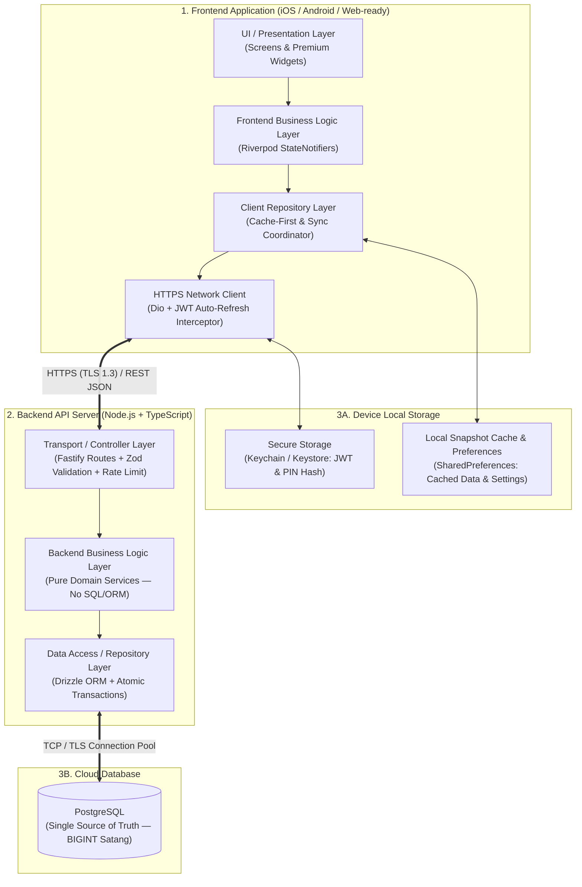
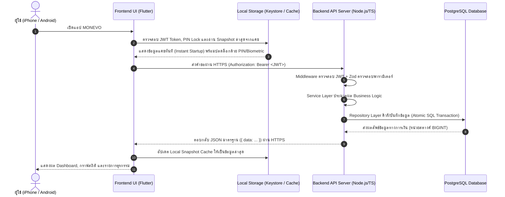

# MONEVO — สถาปัตยกรรมระบบ (System Architecture)

เอกสารนี้อธิบายการออกแบบสถาปัตยกรรมของ **MONEVO** ตามข้อกำหนดหัวข้อ **2. SYSTEM ARCHITECTURE** โดยแบ่งระบบออกเป็น **3 ส่วนหลัก** แยก **Business Logic** ออกจาก **UI** และ **Database** อย่างชัดเจน และออกแบบให้ **เปลี่ยนผู้ให้บริการ Hosting ในอนาคตได้ทันทีโดยไม่ต้องเขียนระบบใหม่**

---

## 1. ภาพรวมสถาปัตยกรรม 3 ส่วนหลัก (3-Tier Architecture + Local Storage)

### หน้าที่ของทั้ง 3 ส่วนหลัก

| ส่วนหลัก | เทคโนโลยี | หน้าที่รับผิดชอบ |
|---|---|---|
| **1. Frontend Application** | Flutter · Dart (`mobile/`) | แสดงผล UI ระดับพรีเมียมบน iPhone และ Android (รวมถึงรองรับการขยายไป Web), รับคำสั่งจากผู้ใช้, ตรวจสอบข้อมูลเบื้องต้น, จัดการสถานะหน้าจอ และสื่อสารกับ Backend ผ่าน HTTPS |
| **2. Backend API Server** | Node.js · TypeScript · Fastify (`backend/`) | ตรวจสอบสิทธิ์ (JWT + Argon2id), ตรวจสอบความถูกต้องของข้อมูล (Zod), ประมวลผลกฎทางธุรกิจและการเงินทั้งหมด, บังคับใช้ความปลอดภัย (Rate Limit, Helmet, CORS) และให้บริการ REST API |
| **3. Database และ Local Storage** | **PostgreSQL** (`backend/drizzle/`) + **Secure Storage & Local Cache** (`mobile/lib/core/storage/`) | **PostgreSQL:** จัดเก็บข้อมูลผู้ใช้ บัญชี หมวดหมู่ และธุรกรรมทางการเงินทั้งหมดในหน่วยย่อย (`BIGINT` สตางค์) อย่างถูกต้องแม่นยำ **Local Storage บนมือถือ:** จัดเก็บ JWT Token/PIN Hash อย่างปลอดภัยใน Keychain/Keystore และเก็บแคชข้อมูลล่าสุด (`LocalCacheService`) เพื่อให้เปิดแอปเห็นข้อมูลได้ทันที |

---

## 2. ลักษณะการทำงานและลำดับการไหลของข้อมูล (End-to-End Data Flow)

---

## 3. การแยก Business Logic ออกจาก UI และ Database อย่างชัดเจน

ระบบบังคับใช้กฎ **One-Way Dependency (พึ่งพาทางเดียว)** เพื่อไม่ให้โค้ดปะปนกัน:

### 3.1 ฝั่ง Backend (`backend/src/modules/<module>/`)
ทุกโมดูล (`auth`, `accounts`, `categories`, `transactions`, `dashboard`) ถูกแยกออกเป็น 3 ชั้นอย่างเคร่งครัด:

| ชั้น (Layer) | ไฟล์ในโปรเจกต์ | สิ่งที่ทำได้ | สิ่งที่ห้ามทำเด็ดขาด |
|---|---|---|---|
| **1. Transport / Controller** | `*.routes.ts`, `*.schemas.ts` | กำหนด HTTP Method/Path, ตรวจสอบ Input/Output ด้วย Zod, เรียกใช้ `Service` | ห้ามเขียนกฎการคำนวณเงิน หรือคิวรีฐานข้อมูลโดยตรง |
| **2. Business Logic (Service)** | `*.service.ts` | กฎทางธุรกิจล้วน ๆ เช่น กฎการเปิดลงทะเบียนเจ้าของคนเดียว, กฎการหมุนเวียน Refresh Token, การคำนวณผลกระทบยอดคงเหลือเมื่อเพิ่ม/แก้/ลบธุรกรรม, การคำนวณ Savings Rate และ Net Worth Trend | **ห้าม import `drizzle-orm` หรือเขียนคำสั่ง SQL** และห้ามผูกกับ HTTP Request/Response |
| **3. Data Access (Repository)** | `*.repository.ts` | คำสั่ง SQL, Drizzle ORM queries, Database Transaction (`db.transaction`) และ Advisory Lock ทั้งหมด | ห้ามตัดสินใจกฎทางธุรกิจหรือจัดการ HTTP Status Code |
| **4. Server Storage Policy Guard (3.2)** | `middleware/storage-policy.ts` | บล็อก `multipart/form-data`, `image/*`, ฟิลด์รูปภาพ (`slip`, `receipt`, `image`, `photo`, `base64`) และ Data URI (`data:image/...;base64,...`) ด้วยรหัส `400 IMAGE_UPLOAD_FORBIDDEN` พร้อมจำกัดขนาด Request Body ที่ 32 KB | ห้ามรับไฟล์ภาพหรือ Base64 ลง PostgreSQL หรือ Cloud Storage โดยเด็ดขาด |

### 3.2 ฝั่ง Frontend (`mobile/lib/features/<feature>/`)
ทุกฟีเจอร์ถูกแยกออกเป็น `presentation/`, `domain/`, และ `data/`:

| ชั้น (Layer) | ไฟล์ในโปรเจกต์ | สิ่งที่ทำได้ | สิ่งที่ห้ามทำเด็ดขาด |
|---|---|---|---|
| **1. UI / Presentation** | `presentation/*_screen.dart`, `core/widgets/*` | วาดหน้าจอ, กราฟ, แอนิเมชัน และส่ง Event ของผู้ใช้ไปยัง Controller | ห้ามเรียก `Dio` (HTTP) หรือ `SharedPreferences` ใน Widget โดยตรง |
| **2. State & Business Logic** | `presentation/*_controller.dart`, `domain/*_model.dart`, `core/utils/money_utils.dart` | จัดการ State ของหน้าจอ, แปลงหน่วยเงินบาท ↔ สตางค์แบบไร้ทศนิยมลอยตัว, เรียกใช้ `Repository` | ห้ามผูกกับ `BuildContext` หรือเขียน HTTP path |
| **3. Data & Local Storage** | `data/*_repository.dart`, `data/*_api.dart`, `core/storage/*` | ประสานงานระหว่างการเรียก HTTPS REST API (`*_api.dart`) กับการจัดเก็บลงอุปกรณ์ (`LocalCacheService`, `SecureStorageService`, `PreferencesService`) | ห้ามยุ่งกับ Widget หรือการนำทางหน้าจอ |

---

## 4. การออกแบบเพื่อรองรับการเปลี่ยน Hosting ในอนาคต (Zero Vendor Lock-in)

ระบบถูกออกแบบตามหลัก **12-Factor App** เพื่อไม่ให้ผูกติดกับผู้ให้บริการ Cloud รายใดรายหนึ่ง:

1. **มาตรฐาน Container (`backend/Dockerfile`):**
   Backend ถูกบรรจุใน Docker Image มาตรฐาน (`node:22-alpine`) ที่รันได้บนทุกผู้ให้บริการที่รองรับ Container หรือ Node.js มาตรฐาน
2. **มาตรฐานการเชื่อมต่อฐานข้อมูล (`DATABASE_URL`):**
   ใช้ไดรเวอร์มาตรฐาน `node-postgres (pg)` คู่กับ Drizzle ORM และไฟล์ SQL Migration มาตรฐาน (`backend/drizzle/*.sql`) จึงย้ายฐานข้อมูลไปยัง PostgreSQL ที่ใดก็ได้โดยไม่ต้องแก้โค้ดแม้แต่บรรทัดเดียว
3. **การตั้งค่าผ่าน Environment Variables 100% (`backend/src/config/env.ts`):**
   ไม่มีการฝัง URL, พอร์ต หรือความลับไว้ในโค้ด
4. **Stateless API Server:**
   Backend ไม่เก็บสถานะเซสชันไว้ในหน่วยความจำหรือไฟล์ในเครื่อง (เก็บ Refresh Token Hash ใน PostgreSQL) จึงเพิ่มจำนวนเครื่อง (Horizontal Scaling) หรือย้ายเครื่องได้ทันที

### ตารางการย้ายผู้ให้บริการ Hosting ในอนาคต (Portability Matrix)

| เป้าหมายในอนาคต | วิธีเปลี่ยนสำหรับ Backend API | วิธีเปลี่ยนสำหรับ PostgreSQL | โค้ดที่ต้องแก้ |
|---|---|---|---|
| **เริ่มต้น (ปัจจุบัน)** | Render Web Service (Docker) | Neon Serverless PostgreSQL | **0 บรรทัด** |
| **ย้ายไป Railway / Fly.io** | ชี้ไปที่ `backend/Dockerfile` และตั้งค่า Env Vars เดิม | ใช้ Railway Postgres หรือเชื่อมต่อ Neon เดิมผ่าน `DATABASE_URL` | **0 บรรทัด** |
| **ย้ายไป Google Cloud / AWS** | Deploy `backend/Dockerfile` บน **Cloud Run** หรือ **AWS App Runner / ECS** | ใช้ **Cloud SQL for PostgreSQL** หรือ **Amazon RDS** แล้วเปลี่ยนค่า `DATABASE_URL` | **0 บรรทัด** |
| **ย้ายไป VPS ส่วนตัว (DigitalOcean / Linode / Hetzner)** | รัน `docker compose --profile full up -d` จากไฟล์ [`docker-compose.yml`](../docker-compose.yml) | ใช้คอนเทนเนอร์ `postgres:17-alpine` ใน `docker-compose.yml` หรือ Managed DB | **0 บรรทัด** |
| **การชี้แอป Flutter ไปยัง Hosting ใหม่** | เปลี่ยนค่า `--dart-define=API_BASE_URL=https://api.new-domain.com/api/v1` ตอนสั่ง build (หรือใช้ Custom Domain เดิมโดยเปลี่ยนแค่ DNS CNAME/A Record ชี้ไปที่ Hosting ใหม่ โดยไม่ต้องอัปเดตแอปมือถือเลย) | – | **0 บรรทัด** |

